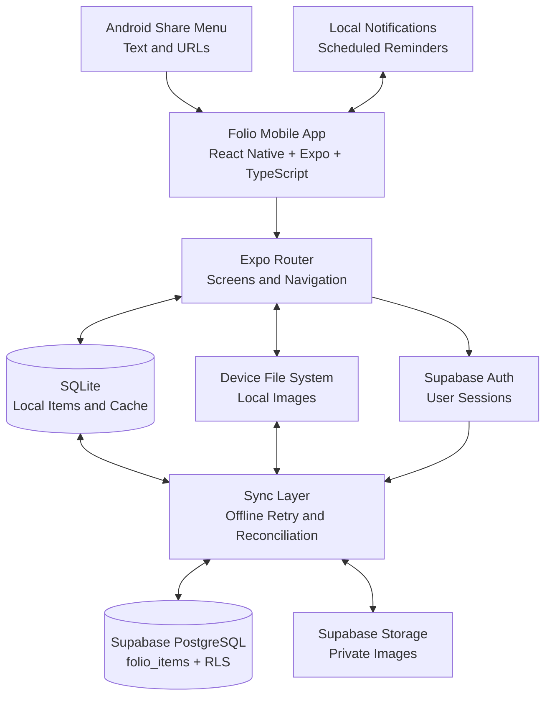

# folio.

**A little space for the things worth keeping.**

Ever saved a link and forgotten where it went? Screenshotted something useful, only to lose it in your gallery? Or had an idea that deserved more than a temporary note?

That's why I built **Folio** — a personal pocket library for the things you want to return to.

**One place. Three ways to save. No unnecessary clutter.**

---

## ✦ What is Folio?

Folio is a cross-platform, local-first save-for-later app built with React Native and Expo. It brings notes, links, and images into one organized library, making it easy to capture something now and find it again later.

**BYTE App Development — Stage 3**

Advanced missions: **A — Better Sync Behaviour** and **D — Resurface an Item Later**

## ✨ What can Folio do?

### Save, organize, rediscover

- **Notes** — Capture ideas, thoughts, and anything worth writing down.
- **Links** — Save useful websites and open them again later.
- **Images** — Keep photos and visual references alongside your other items.
- **Library** — Search, filter, and organize content using tags.
- **Archive** — Put things away without losing them.
- **Recently Deleted** — Restore deleted items before their 30-day cleanup.
- **Appearance** — Switch between Light, Dark, and System themes.

### Your library, on your terms

- **Authentication** — Sign up and sign in with Supabase Auth.
- **Private cloud storage** — Keep account data in Supabase with backend-enforced ownership.
- **Local-first access** — Store saved content on the device using SQLite.
- **Offline synchronization** — Continue saving locally during connectivity problems and retry synchronization.
- **Share into Folio** — Receive text and URLs directly from Android's native Share menu.
- **Remind me later** — Schedule notifications that bring you back to a saved item.

## 🛠️ Built with

| Technology | Purpose |
|---|---|
| React Native | Cross-platform mobile interface |
| Expo | Development, native APIs, and builds |
| TypeScript | Type-safe application code |
| Expo Router | File-based navigation |
| SQLite | Persistent local database |
| Expo File System | Local image storage |
| Supabase Auth | Authentication and sessions |
| Supabase PostgreSQL | Remote item storage |
| Supabase Storage | Private image storage |
| PostgreSQL RLS | Backend-enforced data ownership |
| Expo Notifications | Scheduled reminders |
| EAS Build | Android APK generation |

## 🏗️ Architecture

Folio follows a **local-first architecture**. The app keeps a local copy of saved content for responsive access, while Supabase provides authentication, private cloud storage, and synchronization.



### How it works

**1. Local storage**

Saved items and metadata are stored in SQLite, while image files are kept in the device's file system. This makes the local library available without continuously requesting data from the server.

**2. Authentication**

Supabase Auth manages registration, login, and user sessions. Cloud operations use the authenticated user's session.

**3. Cloud synchronization**

The sync layer coordinates local changes with Supabase PostgreSQL and Storage. When the connection fails, pending changes can be retried once connectivity returns.

**4. Privacy and ownership**

Every cloud item is associated with an `owner_id`. PostgreSQL Row Level Security (RLS) restricts item operations to the authenticated owner. Private storage policies protect uploaded images.

Security is enforced on the backend, not merely by filtering items in the interface.

**5. Native sharing**

Android's Share menu can send text and URLs into Folio. The shared content is presented for review before saving. Unsupported or malformed content is handled without crashing.

**6. Reminders**

Local notifications let users resurface an item at a chosen date and time. Tapping a notification opens the relevant saved item. Reminders are cancelled when their associated item is deleted.

## ⚡ Advanced missions

### Mission A — Better Sync Behaviour

Folio improves reliability when network connectivity is interrupted.

- Locally saved content remains accessible.
- Pending changes can be retried after connection recovery.
- Remote and local items are reconciled to reduce duplication.
- Local image synchronization and deletion handling are included.

**Conflict policy:** Pending local changes are prioritized during reconciliation. Simultaneous edits on different devices are not merged field by field, so an earlier version may be overwritten. This is a known limitation of the current synchronization approach.

### Mission D — Resurface an Item Later

Saved things are only useful if you remember to revisit them.

- Choose a date and time for a reminder.
- Receive a local notification.
- Tap to open the corresponding item.
- Reschedule or cancel an existing reminder.
- Automatically cancel reminders for deleted items.

## 🚀 Getting started

### Requirements

- Node.js and npm
- Expo Go for supported development workflows
- A configured Supabase project
- Android development build or APK for native sharing

### 1. Clone the repository

```bash
git clone https://github.com/sam-tc/folio-app.git
cd folio-app
```

### 2. Install dependencies

```bash
npm install
```

### 3. Configure Supabase

Create a `.env.local` file in the project root:

```env
EXPO_PUBLIC_SUPABASE_URL=your_supabase_project_url
EXPO_PUBLIC_SUPABASE_KEY=your_supabase_publishable_or_anon_key
```

Use the public client key for your Supabase project, not a secret or service-role key.

The Supabase project must have the required database table, Row Level Security policies, and private storage configuration.

### 4. Start Folio

```bash
npx expo start
```

Scan the QR code using Expo Go on a compatible device, or launch a supported simulator.

Some features, including Android's native share integration, require an actual development or standalone build rather than Expo Go.

### 5. Build an Android APK

The repository includes an EAS `preview` profile configured for Android APK generation.

```bash
npx eas-cli login
npx eas-cli build --platform android --profile preview
```

The EAS `preview` environment must contain the required Supabase configuration.

Once the build finishes, Expo provides a build page and an APK download link.

## 🧪 Testing

Folio was developed and tested incrementally, with Git commits marking meaningful milestones.

| Area | Verification |
|---|---|
| Notes, links, images | Local create/edit/save flows tested on iPhone |
| SQLite persistence | Saved content retained across app restarts |
| Archive and Recently Deleted | Archive, restore, delete, and cleanup workflows tested |
| Supabase authentication | Sign-in and private account flows tested |
| Backend privacy | Account B could not read, edit, or delete Account A's protected item |
| Offline behaviour | Offline save and reconnect workflow tested |
| Cloud images | Upload/download and reconciliation workflows tested |
| Android sharing | Chrome Share menu, save, cancel, and closed-app launch tested |
| Reminders | Schedule, delivery, notification tap, reschedule, cancellation, and deleted-item handling tested |

### Known limitations

- Full cross-device behaviour has not been independently verified on two physical devices.
- Concurrent remote edits do not have advanced field-level conflict resolution.
- Android's native Share-menu integration has been tested; equivalent iOS native share-extension behaviour is not claimed.

## 💡 Technical decisions

**Why SQLite and Supabase?**

SQLite provides local persistence and responsive access, while Supabase adds authentication, private remote storage, and synchronization. This avoids making every interaction depend on a network request.

**Why Row Level Security?**

Client-side filtering is not sufficient for privacy. RLS allows PostgreSQL to enforce ownership even if someone attempts to access another user's data directly.

**Why local notifications?**

Reminders can be scheduled on the device without requiring a separate notification server.

**Why Expo?**

Expo simplifies cross-platform development, provides access to native device APIs, and supports generating Android builds through EAS.

## 🌱 What's next?

Potential future improvements include richer conflict resolution, more comprehensive cross-device testing, and extending native sharing support across platforms.

---

### Keep what matters. Find it when it matters.

**Folio** — Built with curiosity, iteration, and a lot of testing.
